# 大学生党务学习平台小程序--论文pf

> 🎓 **计算机毕业设计 · 大学生党务学习平台小程序--论文pf**
>
> 本仓库只放**项目介绍 + 运行截图**（截图是站点带水印的原图，存在仓库 `images/` 里）。
>
> 👉 **完整可运行源码 / 数据库脚本 / 部署文档：[点我获取](https://geekcode.top/archives/%E5%A4%A7%E5%AD%A6%E7%94%9F%E5%85%9A%E5%8A%A1%E5%AD%A6%E4%B9%A0%E5%B9%B3%E5%8F%B0%E5%B0%8F%E7%A8%8B%E5%BA%8F-%E8%AE%BA%E6%96%87pf?utm_source=github)**
>
> 💬 咨询微信：**ir9372**　|　🌐 更多项目：[极客代码 geekcode.top](https://geekcode.top/?utm_source=github)
>
> 📌 项目详情页：<https://geekcode.top/archives/%E5%A4%A7%E5%AD%A6%E7%94%9F%E5%85%9A%E5%8A%A1%E5%AD%A6%E4%B9%A0%E5%B9%B3%E5%8F%B0%E5%B0%8F%E7%A8%8B%E5%BA%8F-%E8%AE%BA%E6%96%87pf?utm_source=github>

<table><td width="230" align="center"> <b>扫码加微信 ir9372</b></td><td valign="middle">📦 源码 = 项目介绍 + 全部运行截图 + 数据库 + 部署文档 👉 点上方任意截图，直接跳到 <b>极客代码 geekcode.top</b> 详情页</td></table>

---

<h1>大学生党务学习平台小程序--论文pf</h1>
<h2>项目概述</h2>

本项目为“大学生党务学习平台小程序”，旨在构建一个集党课学习、在线考试、入党申请管理及党务档案维护于一体的综合性服务平台。系统采用前后端分离架构，前端基于微信小程序技术栈，后端基于 Java Spring Boot 框架开发。核心功能涵盖党课资源浏览与收藏、在线试卷生成与考试、签到管理、入党申请流程跟踪以及个人党务档案管理。适用人群主要为高校学生党员及入党积极分子，管理员可通过 Web 后台进行内容发布与用户管理。该项目通过移动端便捷入口，解决了传统党务学习中信息获取滞后、互动性差的问题，实现了党务工作的数字化与规范化。

<h2>技术架构</h2>
<h3>1. 总体架构</h3>

系统采用典型的 B/S（浏览器/服务器）与 C/S（客户端/服务器）混合模式。

<ul>
<li><strong>前端</strong>：分为两部分。一是面向用户的微信小程序端，负责数据展示、交互逻辑及用户认证；二是面向管理员的 Web 后台管理端，基于 Thymeleaf模板引擎渲染页面，结合 Vue.js 实现动态交互。</li>
<li><strong>后端</strong>：基于 Spring Boot 框架构建 RESTful API 服务，处理业务逻辑、权限校验及数据持久化。</li>
<li><strong>数据库</strong>：使用 MySQL 存储业务数据，MyBatis-Plus 作为 ORM 映射工具简化 CRUD 操作。</li>
</ul>
<h3>2. 核心技术选型理由</h3>
<ul>
<li><strong>Spring Boot</strong>: 提供快速开发能力，内置 Tomcat 容器，简化配置，适合构建微服务或单体应用的后端接口。</li>
<li><strong>MyBatis-Plus</strong>: 在 MyBatis 基础上增强，提供了通用的 CRUD 接口和条件构造器，显著减少样板代码，提高开发效率。</li>
<li><strong>Apache Shiro</strong>: 用于身份认证和授权管理，确保后台管理员及小程序用户的安全访问控制。</li>
<li><strong>Thymeleaf + Vue</strong>: 后台管理界面采用服务端渲染（SSR）结合前端框架的方式，既保证了 SEO 友好性和初始加载速度，又提供了良好的用户体验。</li>
<li><strong>微信小程序</strong>: 利用微信生态的高渗透率，无需下载安装即可使用，便于在学生群体中推广。</li>
</ul>
<h3>3. 前后端交互方式</h3>

小程序前端与 Java 后端通过 HTTPS 协议下的 REST API 进行通信。后端 Controller 层定义 JSON 格式的输入输出接口，前端发起 HTTP 请求获取数据并渲染至视图层。身份验证通常通过 Token 机制实现，用户在登录后获取令牌，后续请求携带该令牌以通过 Shiro 过滤器校验。

<a href="https://geekcode.top/archives/%E5%A4%A7%E5%AD%A6%E7%94%9F%E5%85%9A%E5%8A%A1%E5%AD%A6%E4%B9%A0%E5%B9%B3%E5%8F%B0%E5%B0%8F%E7%A8%8B%E5%BA%8F-%E8%AE%BA%E6%96%87pf?utm_source=github" title="查看完整源码">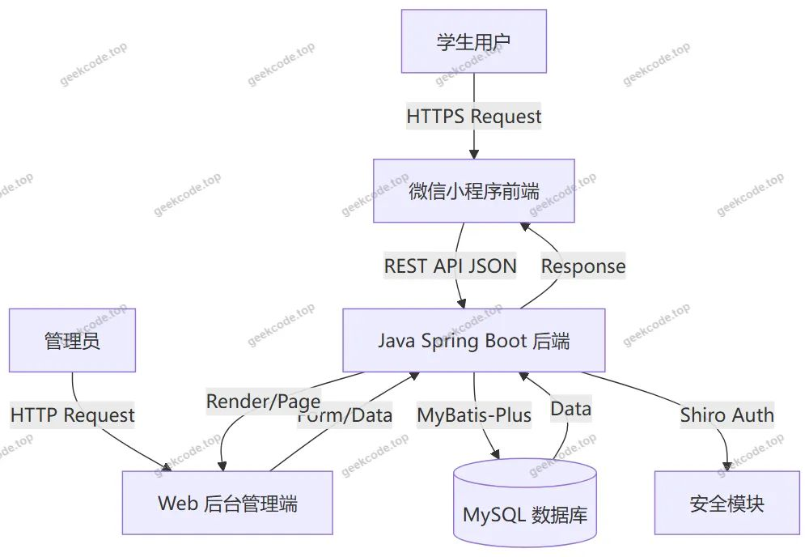</a>

<h2>功能模块</h2>

根据源码中的 Controller 列表、路由配置及截图所示功能，系统主要划分为小程序用户端和 Web 后台管理端两大模块。

<h3>1. 小程序用户端功能</h3>

小程序端主要服务于学生用户，提供党务学习与管理服务。

<h4>1.1 用户基础模块</h4>
<ul>
<li><strong>注册与登录</strong>：支持账号密码注册、登录，包含忘记密码找回功能。</li>
<li><strong>个人中心</strong>：查看和修改个人信息（如头像、昵称等），修改密码。</li>
<li><strong>消息提醒</strong>：接收系统通知、审核结果反馈等提醒列表。</li>
</ul>
<h4>1.2 党课学习与管理模块</h4>
<ul>
<li><strong>党课浏览</strong>：查看党课列表，支持按分类筛选。</li>
<li><strong>党课详情与报名</strong>：查看党课具体内容，进行在线报名（确认报名状态）。</li>
<li><strong>互动功能</strong>：对党课进行收藏、评价留言。</li>
<li><strong>我的记录</strong>：查看个人的党课收藏列表、评价列表及报名记录。</li>
</ul>
<h4>1.3 在线考试模块</h4>
<ul>
<li><strong>试卷中心</strong>：查看可用试卷列表。</li>
<li><strong>在线答题</strong>：进入考试界面进行选题作答。</li>
<li><strong>成绩与回顾</strong>：查看考试记录列表，查阅错题本以巩固知识点。</li>
</ul>
<h4>1.4 党务事务模块</h4>
<ul>
<li><strong>入党申请</strong>：提交入党申请书，查看申请进度列表。</li>
<li><strong>签到管理</strong>：参与线下或线上活动签到，查看签到信息列表。</li>
<li><strong>作业管理</strong>：查看布置的作业列表，提交作业内容，查看作业提交状态。</li>
<li><strong>在线学习</strong>：浏览学习资料，支持收藏和留言互动。</li>
<li><strong>档案管理</strong>：查看个人党务档案列表。</li>
</ul>
<h4>1.5 公告资讯模块</h4>
<ul>
<li><strong>公告信息</strong>：查看党组织发布的最新通知公告。</li>
</ul>
<h3>2. Web 后台管理端功能</h3>

后台管理端主要服务于管理员，用于维护系统数据和业务流程。

<h4>2.1 系统管理模块</h4>
<ul>
<li><strong>管理员管理</strong>：新增、编辑、删除管理员账号，重置密码。</li>
<li><strong>配置管理</strong>：系统参数配置，包括轮播图（huanyuan）、备份恢复（beifen）等功能。</li>
<li><strong>字典管理</strong>：维护系统中的各类枚举值和数据字典，如性别、课程类型、申请状态、作业提交状态等。</li>
</ul>
<h4>2.2 业务数据管理模块</h4>
<ul>
<li><strong>党课管理</strong>：<ul>
<li>党课基本信息维护（增删改查）。</li>
<li>党课评论管理（回复或删除用户评价）。</li>
<li>党课报名订单管理（审核报名申请）。</li>
<li>党课收藏数据查看。</li>
</ul>
</li>
<li><strong>考试管理</strong>：<ul>
<li>试卷管理：创建、编辑、删除试卷。</li>
<li>试题管理：维护题库中的具体题目（Examquestion）。</li>
<li>试卷选题：将题目关联到特定试卷（Exampapertopic）。</li>
<li>考试记录：查看学生的考试成绩和详细记录。</li>
</ul>
</li>
<li><strong>党务档案管理</strong>：<ul>
<li>档案信息维护：录入和管理学生/党员的电子档案。</li>
</ul>
</li>
<li><strong>其他业务管理</strong>：<ul>
<li>公告管理：发布和管理前台显示的公告信息。</li>
<li>签到管理：查看和处理考勤数据。</li>
<li>作业管理：发布作业，审核作业提交情况。</li>
<li>入党申请管理：审核用户的入党申请状态。</li>
<li>在线学习管理：维护学习资料库及其互动数据。</li>
</ul>
</li>
</ul>
<h2>用户角色与权限</h2>

系统主要包含两类用户角色：普通学生用户和管理员。

<h3>1. 普通学生用户（小程序端）</h3>
<ul>
<li><strong>权限范围</strong>：仅能访问和操作与自己相关的数据。</li>
<li><strong>具体功能权限</strong>：<ul>
<li><strong>只读权限</strong>：浏览党课列表、公告信息、在线学习资料、作业列表、试卷列表。</li>
<li><strong>写入权限</strong>：注册账号、修改个人信息、报名党课、收藏党课/资料、发表评价/留言、提交作业、参加考试、提交入党申请、进行签到。</li>
<li><strong>查询权限</strong>：查看自己的报名记录、收藏列表、评价列表、考试记录、错题本、作业提交状态、入党申请进度、个人档案。</li>
</ul>
</li>
<li><strong>限制</strong>：无法访问 Web 后台管理页面，无法修改系统配置或其他用户数据。</li>
</ul>
<h3>2. 管理员（Web 后台端）</h3>
<ul>
<li><strong>权限范围</strong>：拥有系统最高权限，可进行全局数据管理和系统配置。</li>
<li><strong>具体功能权限</strong>：<ul>
<li><strong>系统设置</strong>：管理管理员账号、修改系统配置、执行数据备份与还原、维护数据字典。</li>
<li><strong>内容发布与维护</strong>：增删改查党课信息、发布公告、上传在线学习资料、发布作业、创建试卷和试题。</li>
<li><strong>审核与管理</strong>：审核党课报名申请、回复或删除党课评论、审核入党申请、检查作业提交情况、查看签到统计。</li>
<li><strong>数据监控</strong>：查看所有用户的考试记录、收藏数据、评价数据、档案信息等。</li>
</ul>
</li>
<li><strong>限制</strong>：通常不直接参与小程序端的日常学习活动（如报名、考试），其职责侧重于监管和维护。</li>
</ul>
<h2>项目特色与创新点</h2>
<ol>
<li>
<strong>全流程党务数字化闭环</strong>：
项目不仅涵盖了常规的“学”（党课、资料、考试），还深入到了“管”（档案、申请、签到）和“评”（作业、评价）环节。从入党申请提交到最终成为党员后的持续教育，形成了完整的生命周期管理，避免了传统模式下各环节数据割裂的问题。

</li>
<li>
<strong>灵活的多维考核体系</strong>：
集成了在线考试、错题回顾、作业提交与审核等多种考核方式。特别是“试卷选题”与“错题列表”功能的结合，能够为学生提供个性化的复习路径，同时管理员可通过考试记录和作业完成情况量化学习效果。

</li>
<li>
<strong>轻量级移动优先体验</strong>：
依托微信小程序生态，降低了用户使用门槛。学生无需安装额外 APP 即可完成签到、学习和申请等操作，极大地提高了参与度和活跃度。后台采用 Spring Boot + Shiro 保障了数据的安全性与接口的规范性。

</li>
<li>
<strong>精细化数据字典驱动</strong>：
系统设计了丰富的数据字典（如 <code>dictionaryDangkeOrder</code>, <code>dictionaryZuoyeTijiaoYesno</code> 等），使得业务状态（如报名成功、作业已批阅、申请待审）的管理更加标准化和可扩展，便于后续功能的迭代与维护。

</li>
</ol>
<h2>部署环境</h2>

为了确保项目的正常运行，需要搭建以下软硬件环境：

<h3>1. 硬件环境</h3>
<ul>
<li><strong>服务器</strong>：建议 CPU 2核及以上，内存 4GB 及以上，硬盘 50GB 以上（用于存储数据库日志及上传文件）。</li>
<li><strong>开发机</strong>：普通 PC 电脑，内存 8GB 以上，具备互联网连接。</li>
</ul>
<h3>2. 软件环境</h3>
<ul>
<li><strong>操作系统</strong>：Windows 10/11 或 Linux (CentOS 7+/Ubuntu 20+)。</li>
<li><strong>JDK 版本</strong>：Java Development Kit 1.8 或更高版本（推荐 JDK 8，兼容性好）。</li>
<li><strong>数据库</strong>：MySQL 5.7 或 MySQL 8.0+。需初始化数据库脚本以建立表结构。</li>
<li><strong>构建工具</strong>：Maven 3.6+（用于后端依赖管理）。</li>
<li><strong>前端开发工具</strong>：<ul>
<li><strong>微信开发者工具</strong>：最新版本，用于小程序端的代码编写、调试和预览。</li>
<li><strong>Node.js &amp; npm</strong>：若小程序前端涉及构建步骤，可能需要 Node.js 环境（视具体工程配置而定，原生小程序通常只需开发者工具）。</li>
<li><strong>IDE</strong>：IntelliJ IDEA 或 Eclipse（用于 Java 后端开发）。</li>
</ul>
</li>
<li><strong>Web 服务器</strong>：Nginx 或 Apache（可选，用于反向代理或静态资源托管，Spring Boot 内置 Tomcat 可直接运行）。</li>
</ul>
<h3>3. 关键配置说明</h3>
<ul>
<li><strong>application.yml</strong>：需配置正确的 MySQL 连接 URL、用户名、密码。</li>
<li><strong>Shiro 配置</strong>：需根据实际部署地址调整回调 URL 或 Session 超时时间。</li>
<li><strong>小程序 AppID</strong>：需在微信公众平台注册小程序账号，获取 AppID 并填入前端配置文件，以便进行真机调试和发布。</li>
</ul>
<h2>五、技术特性</h2>
<ul>
<li>前后端集成部署，前端资源打包至后端 static 目录</li>
<li>使用 MyBatis-Plus 简化数据访问层开发</li>
<li>集成 Shiro 权限框架实现角色权限控制</li>
</ul>
<h2>六、功能模块截图</h2>
<h3>微信小程序用户端</h3>

<figure><a href="https://geekcode.top/archives/%E5%A4%A7%E5%AD%A6%E7%94%9F%E5%85%9A%E5%8A%A1%E5%AD%A6%E4%B9%A0%E5%B9%B3%E5%8F%B0%E5%B0%8F%E7%A8%8B%E5%BA%8F-%E8%AE%BA%E6%96%87pf?utm_source=github" title="查看完整源码">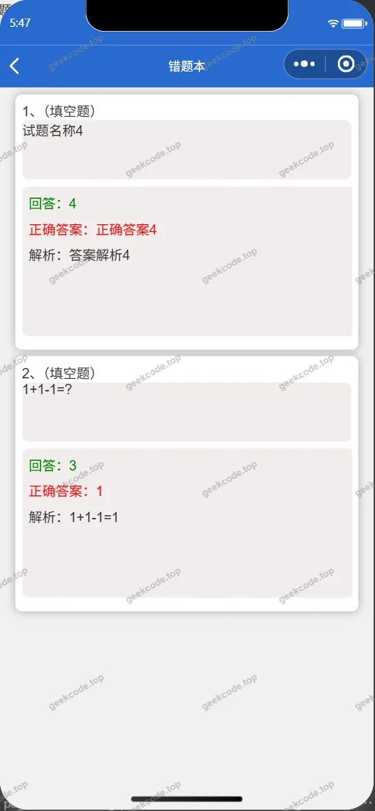</a><figcaption>小程序-错题列表</figcaption></figure>
<figure><figcaption>小程序-党课</figcaption></figure>
<figure><a href="https://geekcode.top/archives/%E5%A4%A7%E5%AD%A6%E7%94%9F%E5%85%9A%E5%8A%A1%E5%AD%A6%E4%B9%A0%E5%B9%B3%E5%8F%B0%E5%B0%8F%E7%A8%8B%E5%BA%8F-%E8%AE%BA%E6%96%87pf?utm_source=github" title="查看完整源码">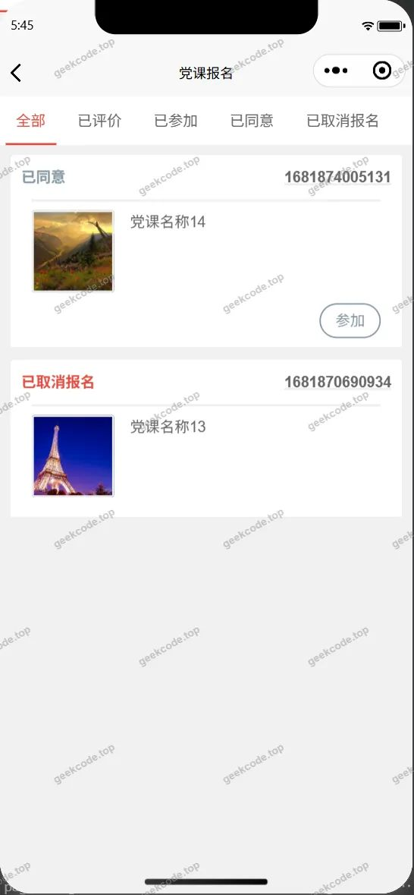</a><figcaption>小程序-党课报名列表</figcaption></figure>
<figure><figcaption>小程序-党课报名confirm</figcaption></figure>
<figure><figcaption>小程序-党课评价列表</figcaption></figure>
<figure><figcaption>小程序-党课收藏列表</figcaption></figure>
<figure><a href="https://geekcode.top/archives/%E5%A4%A7%E5%AD%A6%E7%94%9F%E5%85%9A%E5%8A%A1%E5%AD%A6%E4%B9%A0%E5%B9%B3%E5%8F%B0%E5%B0%8F%E7%A8%8B%E5%BA%8F-%E8%AE%BA%E6%96%87pf?utm_source=github" title="查看完整源码">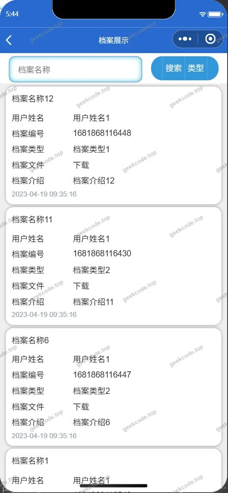</a><figcaption>小程序-档案列表</figcaption></figure>
<figure><a href="https://geekcode.top/archives/%E5%A4%A7%E5%AD%A6%E7%94%9F%E5%85%9A%E5%8A%A1%E5%AD%A6%E4%B9%A0%E5%B9%B3%E5%8F%B0%E5%B0%8F%E7%A8%8B%E5%BA%8F-%E8%AE%BA%E6%96%87pf?utm_source=github" title="查看完整源码">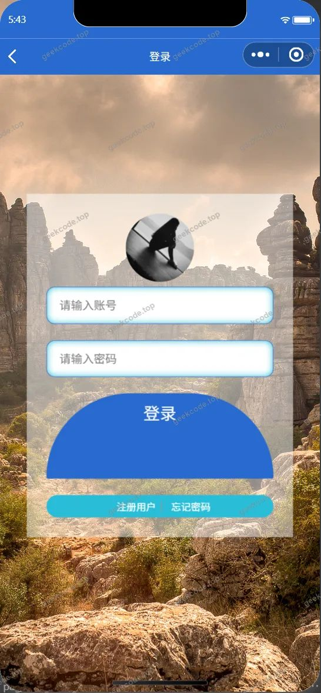</a><figcaption>小程序-登录</figcaption></figure>
<figure><figcaption>小程序-个人信息userinfo</figcaption></figure>
<figure><figcaption>小程序-公告信息</figcaption></figure>
<figure><figcaption>小程序-考试记录列表</figcaption></figure>
<figure><figcaption>小程序-签到信息列表</figcaption></figure>
<figure><figcaption>小程序-入党申请列表</figcaption></figure>
<figure><a href="https://geekcode.top/archives/%E5%A4%A7%E5%AD%A6%E7%94%9F%E5%85%9A%E5%8A%A1%E5%AD%A6%E4%B9%A0%E5%B9%B3%E5%8F%B0%E5%B0%8F%E7%A8%8B%E5%BA%8F-%E8%AE%BA%E6%96%87pf?utm_source=github" title="查看完整源码">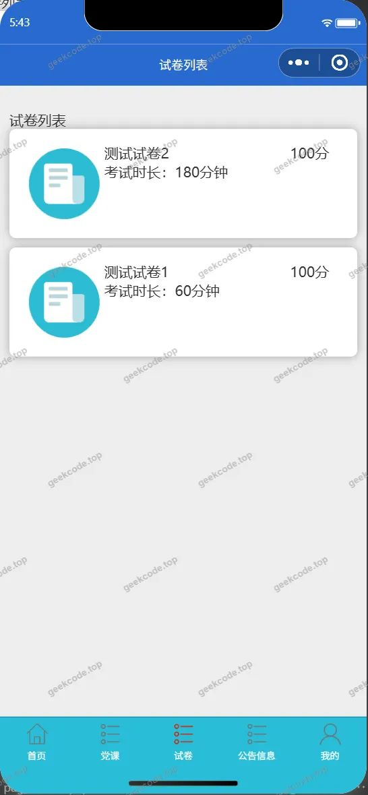</a><figcaption>小程序-试卷</figcaption></figure>
<figure><a href="https://geekcode.top/archives/%E5%A4%A7%E5%AD%A6%E7%94%9F%E5%85%9A%E5%8A%A1%E5%AD%A6%E4%B9%A0%E5%B9%B3%E5%8F%B0%E5%B0%8F%E7%A8%8B%E5%BA%8F-%E8%AE%BA%E6%96%87pf?utm_source=github" title="查看完整源码">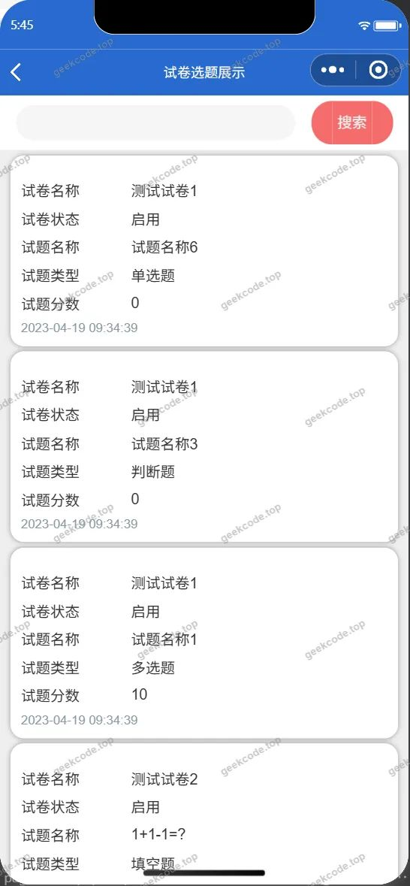</a><figcaption>小程序-试卷选题列表</figcaption></figure>
<figure><a href="https://geekcode.top/archives/%E5%A4%A7%E5%AD%A6%E7%94%9F%E5%85%9A%E5%8A%A1%E5%AD%A6%E4%B9%A0%E5%B9%B3%E5%8F%B0%E5%B0%8F%E7%A8%8B%E5%BA%8F-%E8%AE%BA%E6%96%87pf?utm_source=github" title="查看完整源码">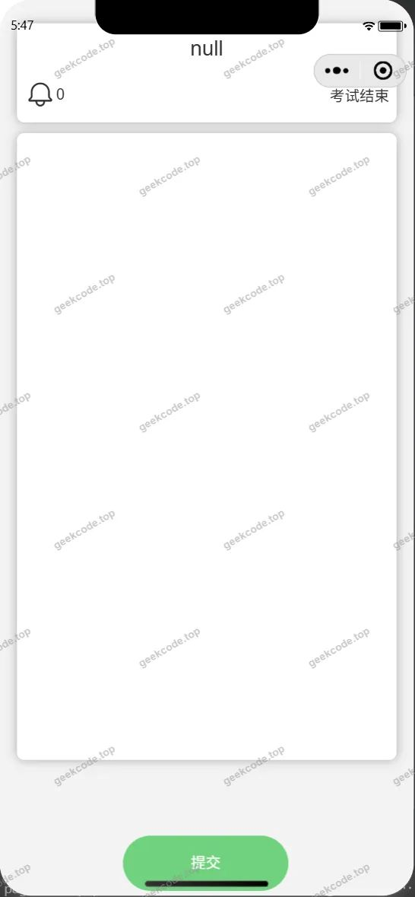</a><figcaption>小程序-试卷exam</figcaption></figure>
<figure><figcaption>小程序-首页</figcaption></figure>
<figure><figcaption>小程序-提醒列表</figcaption></figure>
<figure><figcaption>小程序-忘记密码</figcaption></figure>
<figure><a href="https://geekcode.top/archives/%E5%A4%A7%E5%AD%A6%E7%94%9F%E5%85%9A%E5%8A%A1%E5%AD%A6%E4%B9%A0%E5%B9%B3%E5%8F%B0%E5%B0%8F%E7%A8%8B%E5%BA%8F-%E8%AE%BA%E6%96%87pf?utm_source=github" title="查看完整源码">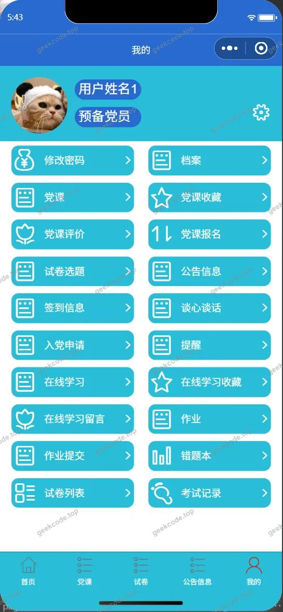</a><figcaption>小程序-我的</figcaption></figure>
<figure><figcaption>小程序-在线学习列表</figcaption></figure>
<figure><figcaption>小程序-在线学习留言列表</figcaption></figure>
<figure><figcaption>小程序-在线学习收藏列表</figcaption></figure>
<figure><a href="https://geekcode.top/archives/%E5%A4%A7%E5%AD%A6%E7%94%9F%E5%85%9A%E5%8A%A1%E5%AD%A6%E4%B9%A0%E5%B9%B3%E5%8F%B0%E5%B0%8F%E7%A8%8B%E5%BA%8F-%E8%AE%BA%E6%96%87pf?utm_source=github" title="查看完整源码">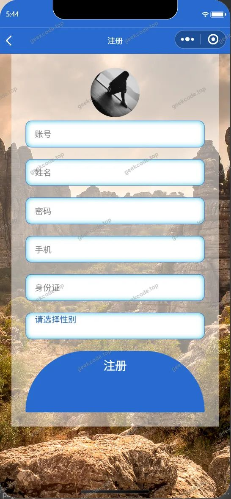</a><figcaption>小程序-注册</figcaption></figure>
<figure><figcaption>小程序-作业列表</figcaption></figure>
<figure><figcaption>小程序-作业提交列表</figcaption></figure>
<figure><figcaption>小程序-changepassword</figcaption></figure>

<h3>后台管理端</h3>
<h4>后台-党课</h4>

<a href="https://geekcode.top/archives/%E5%A4%A7%E5%AD%A6%E7%94%9F%E5%85%9A%E5%8A%A1%E5%AD%A6%E4%B9%A0%E5%B9%B3%E5%8F%B0%E5%B0%8F%E7%A8%8B%E5%BA%8F-%E8%AE%BA%E6%96%87pf?utm_source=github" title="查看完整源码">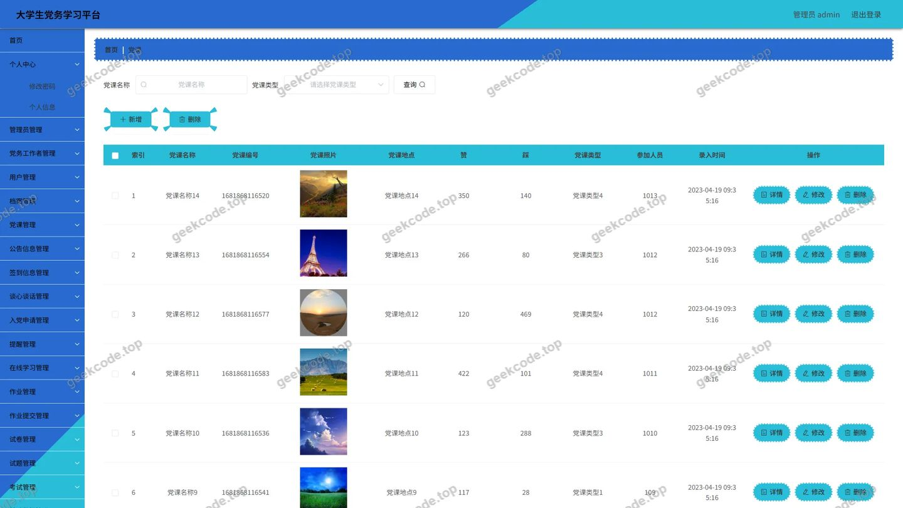</a>

<h4>后台-档案</h4>

<a href="https://geekcode.top/archives/%E5%A4%A7%E5%AD%A6%E7%94%9F%E5%85%9A%E5%8A%A1%E5%AD%A6%E4%B9%A0%E5%B9%B3%E5%8F%B0%E5%B0%8F%E7%A8%8B%E5%BA%8F-%E8%AE%BA%E6%96%87pf?utm_source=github" title="查看完整源码">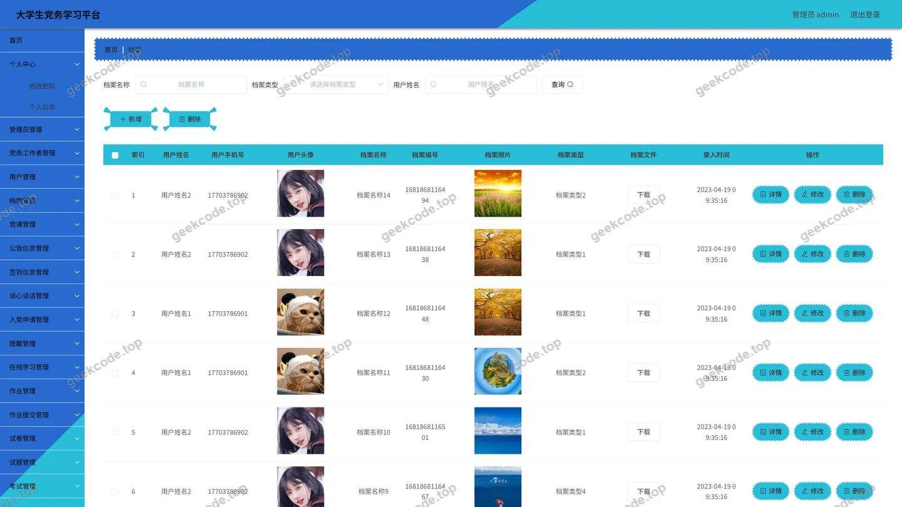</a>

<h4>后台-登录页</h4>

<h4>后台-管理员</h4>

<a href="https://geekcode.top/archives/%E5%A4%A7%E5%AD%A6%E7%94%9F%E5%85%9A%E5%8A%A1%E5%AD%A6%E4%B9%A0%E5%B9%B3%E5%8F%B0%E5%B0%8F%E7%A8%8B%E5%BA%8F-%E8%AE%BA%E6%96%87pf?utm_source=github" title="查看完整源码">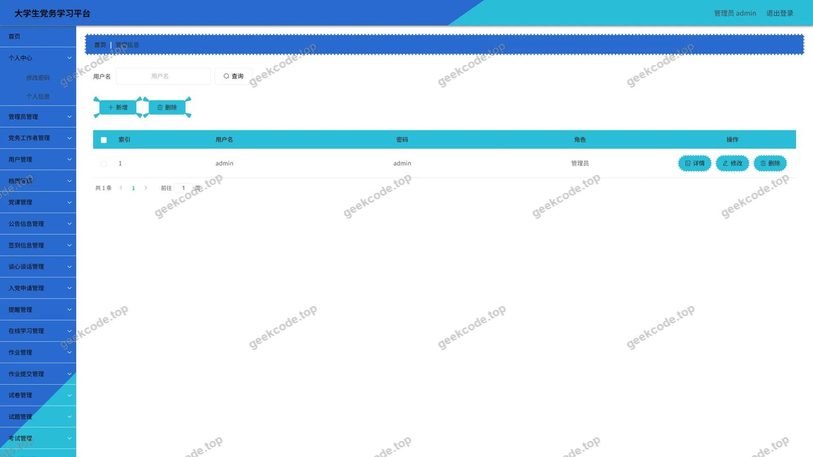</a>

<h4>后台-配置文件</h4>

<a href="https://geekcode.top/archives/%E5%A4%A7%E5%AD%A6%E7%94%9F%E5%85%9A%E5%8A%A1%E5%AD%A6%E4%B9%A0%E5%B9%B3%E5%8F%B0%E5%B0%8F%E7%A8%8B%E5%BA%8F-%E8%AE%BA%E6%96%87pf?utm_source=github" title="查看完整源码">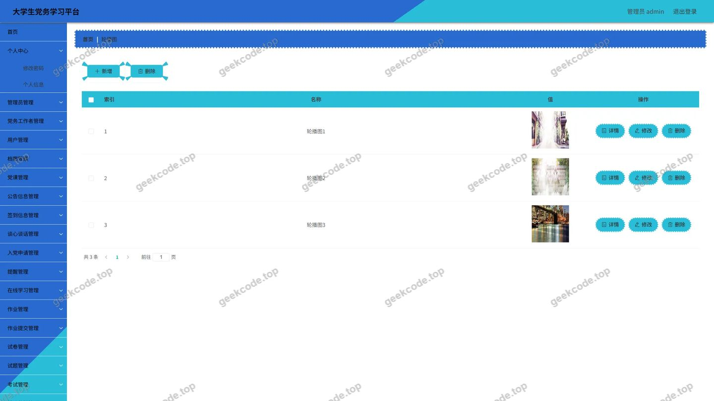</a>

<h4>后台-试卷</h4>

<a href="https://geekcode.top/archives/%E5%A4%A7%E5%AD%A6%E7%94%9F%E5%85%9A%E5%8A%A1%E5%AD%A6%E4%B9%A0%E5%B9%B3%E5%8F%B0%E5%B0%8F%E7%A8%8B%E5%BA%8F-%E8%AE%BA%E6%96%87pf?utm_source=github" title="查看完整源码">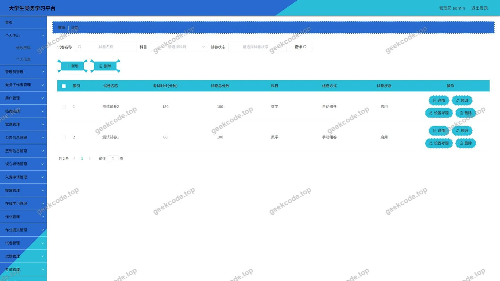</a>

<h4>后台-试卷选题</h4>

<a href="https://geekcode.top/archives/%E5%A4%A7%E5%AD%A6%E7%94%9F%E5%85%9A%E5%8A%A1%E5%AD%A6%E4%B9%A0%E5%B9%B3%E5%8F%B0%E5%B0%8F%E7%A8%8B%E5%BA%8F-%E8%AE%BA%E6%96%87pf?utm_source=github" title="查看完整源码">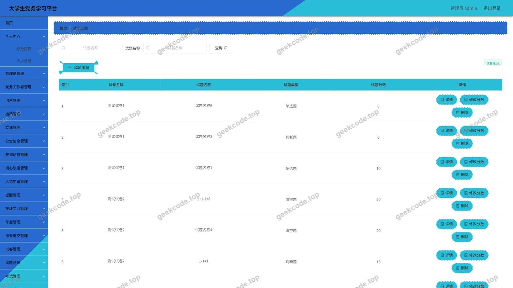</a>

<h4>后台首页</h4>

<a href="https://geekcode.top/archives/%E5%A4%A7%E5%AD%A6%E7%94%9F%E5%85%9A%E5%8A%A1%E5%AD%A6%E4%B9%A0%E5%B9%B3%E5%8F%B0%E5%B0%8F%E7%A8%8B%E5%BA%8F-%E8%AE%BA%E6%96%87pf?utm_source=github" title="查看完整源码">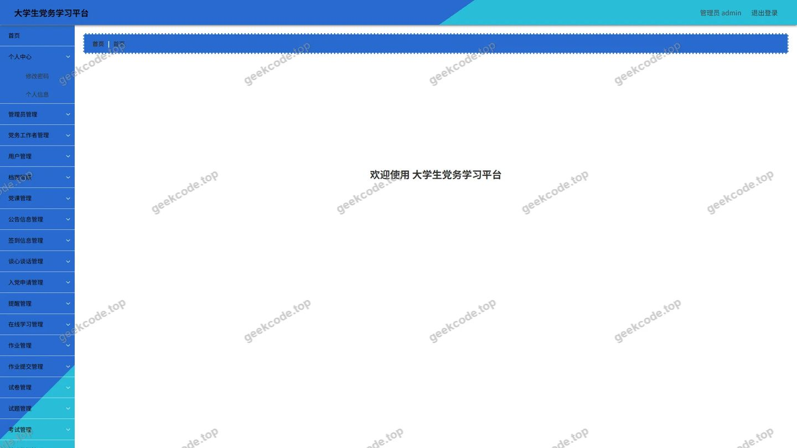</a>

---

## 获取完整源码

| 项目 | 说明 |
| --- | --- |
| 项目名 | 大学生党务学习平台小程序--论文pf |
| 运行截图 | 本文 36 张（站点带水印原图，仓库 `images/` 目录） |
| 完整源码 | [https://geekcode.top/archives/%E5%A4%A7%E5%AD%A6%E7%94%9F%E5%85%9A%E5%8A%A1%E5%AD%A6%E4%B9%A0%E5%B9%B3%E5%8F%B0%E5%B0%8F%E7%A8%8B%E5%BA%8F-%E8%AE%BA%E6%96%87pf?utm_source=github](https://geekcode.top/archives/%E5%A4%A7%E5%AD%A6%E7%94%9F%E5%85%9A%E5%8A%A1%E5%AD%A6%E4%B9%A0%E5%B9%B3%E5%8F%B0%E5%B0%8F%E7%A8%8B%E5%BA%8F-%E8%AE%BA%E6%96%87pf?utm_source=github) |
| 咨询微信 | **ir9372**（备注：jingpin-yuanma） |
| 更多项目 | [极客代码 geekcode.top](https://geekcode.top/?utm_source=github) |

> 需要源码、部署、改配置、跑不起来等问题，加微信 ir9372 沟通，说明项目名即可。
